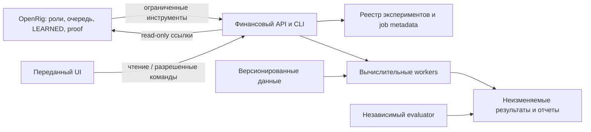

# Polar: платформа, развертывание и предметные данные

## v0.33 — Действующая миссия

Текущий авторизованный этап определен в [миссии широких исследований](missions/02-wide-research/SPEC.md). Правила ниже применяются при согласовании текущих заданий.

## v0.33 — Исполнимый CI, ревью и непрерывное исследование

Основной технический путь — существующие GitHub Actions и scripts/ci.sh на проверяемом кандидате. Остаточные PR переводятся на него с сохранением полезных тестов, ошибок и применимых независимых результатов. Локальная процедура остается при конкретной потребности потребителя, например разрешенном исполнении private данных. DevOps обеспечивает воспроизводимую среду и пригодный к чтению результат CI с commit, command/runtime, фактически запущенными наборами, counts/skips/errors и диагностикой. QA сверяет применимость и проверяет конкретный пробел покрытия. Ошибка доступа к артефакту передается DevOps как действие с сохранением уже готового содержательного вывода.

QA возвращает завершенную часть review сразу вместе с конкретной недостающей операцией и ее владельцем. QA Code распределяет компетентных независимых проверяющих и принимает техническое решение по совокупности применимых результатов. Lead в существующей часовой диагностике проверяет содержательное продвижение и время ожидания. При застревании уточняет остаток, приоритизирует исправление инструмента или перераспределяет подготовленный объем с сохранением независимости. Частота проверки служит сигналом вмешательства. Время качественного review определяется риском изменения.

Quants выбирают дальнейшие экономические вопросы и обращаются непосредственно к DE/DR и инженерам за данными и capabilities. Конечный эксперимент передает результат потребителю и следующий шаг в рамках постоянного мандата. Размер universe/истории обосновывается исследованием, временные ограничения порождают конкретную задачу данных. Статусы инфраструктурной проверки, ограниченного исследования и подтверждения стратегии сохраняются раздельно.

График перемещается локально по готовому буферу. Подгрузка candles/series выполняется заблаговременно с кэшем по revision/instrument/basis/параметрам, корректным warmup и отбрасыванием устаревших ответов. Ожидание индикатора отображается локально, взаимодействие с доступными данными продолжается. Численные цели и объемы конкретного этапа заданы в [миссии широких исследований](missions/02-wide-research/SPEC.md).

Миссия содержит новый T0 и результаты 2/4/6/8ч. Старый CI8h8390 закрыт DELIVERED_LATE и сохранен как история. Часовой контроль использует существующий job. Новые изменения процедур записываются в существующем журнале с фактическим эффектом.

Раздел «Архитектура» ниже описывает целевой состав сервиса. Фактическая реализация компонентов, хранилищ, подключений и runtime определяется по принятым версиям и отдельным доказательствам исполнения, а не по наличию этого описания.

## Архитектура

Агенты владеют выбором действий и интерпретацией; обычный код — загрузкой по расписанию, расчетами, ledger, квотами, сохранением и выдачей UI. Отсутствие активного LLM-turn не должно останавливать уже запущенный job, обновление котировок или отображение сервиса.

Нативные OpenRig assignments связываются с experiment ID. Вычислительные jobs принадлежат финансовому сервису: это операции с конфигурацией и результатом, не задачи сотрудников и не второй workflow OpenRig.

## Технологический ориентир

Базовый выбор для реализации: Python для исследовательского/расчетного слоя, Parquet для версионированных таблиц, PostgreSQL для metadata, файловое хранилище артефактов на первом хосте, versioned HTTP API и CLI к одним прикладным операциям. API выдает timestamps, units и явные null/status; OpenAPI-контракт уточняется при передаче внешнего UI, не блокируя разработку расчетного слоя.

Это архитектурные решения, а не обещание установленного SDK. Конкретные Python-библиотеки, backtest engine, версии PostgreSQL/Python, окружение и lockfile выбираются оператором/Platform Engineer до реализации и фиксируются с проверкой официальной текущей документации. Использовать готовый движок можно только после qualification контрактов времени, corporate actions, ledger и затрат. Выбор библиотеки не является доказательством их корректности.

Работать на согласованном локальном хосте. CPU/RAM и число workers выбираются по текущей измеренной доступности хоста без фиксированного проектного CPU/RAM потолка; при риске starvation сериализовать или отложить работу. Один общий local storage ceiling64GiB включает retained/scratch/logs/backups; GPU/платные ресурсы и LLM spend остаются отдельно ограничены. Distributed execution добавляется по измеренной необходимости. Frontend framework определяется переданным UI, а не выбирается ригом заново.

## Контейнерное развертывание

Контракт развертывания является частью этого файла. `compose.yaml`, Dockerfiles, lockfiles и скрипты — его будущая реализация в кодовом workspace `polar`, а не отдельная спецификация. OpenRig и seats `polar-rig` остаются в существующем агентном runtime; контейнеризуются компоненты финансового сервиса.

### Жизненный цикл временных Docker-ресурсов — дополнение 2026-11-09

Каждый локально управляемый временный контейнер, одноразовая сеть или volume вне стандартного lifecycle CI job имеет identity record: project/native task/attempt/owner, exact engine ID и проверяемые ownership labels, ожидаемый срок или terminal condition и cleanup owner. Существующие launch/binding labels сохраняются; recovery lookup identity записывается до create, чтобы неизвестный эффект создания можно было согласовать. Принятый helper выполняет ограниченный exact-owned cleanup через finally при success/failure/cancel/timeout и частичном setup; при необходимости используется существующий native recovery guard. Завершение процесса/контейнера не означает удаление Docker-ресурса. REMOVED/CLEANED/PASS допускается только после наблюдаемого отсутствия exact ID; оставшиеся ресурсы, недоступная проверка или неизвестный create-effect сохраняют фактический статус/UNKNOWN и требуют durable result либо передачи конкретному живому recovery owner.

QA preparation может намеренно сохранить частичные ресурсы для inspection/recovery; такой результат обязан назвать exact cleanup или живую ограниченную recovery-передачу. Это не cleanup PASS и не доказательство дефекта только по факту retention.

Перед удалением согласовать владение, активные jobs/guard и роль данных; stopped/old/created само по себе не доказывает abandoned. Не применять broad prune или удаление только по имени. Сохранять рабочие services/jobs, source/immutable experiment artifacts, database volumes, cursor keys, необходимые images и чужие/неизвестные ресурсы. Исключение для retained diagnostic/QA/rollback требует причины, владельца и release condition или expiry; durable evidence хранится в артефактах, а не бессрочно в container shell. Старые явные указания сохранять shells/networks остаются историческим свидетельством политики, не доказательством дефекта современного cleanup. Existing hourly reconciliation может проверять конкретные исключения без нового scheduler/controller или per-run Lead approval. Измененный operational code принимается после независимой affected QA; документация отдельно от фактической adoption и проверенного consumer effect. SRE владеет фактической уборкой и эксплуатационным применением; новые product/financial gates не вводятся.

### Состав первого контура

| Компонент | Ответственность | Постоянные данные |
|---|---|---|
| `db` | PostgreSQL: реестр, конфигурации, jobs и портфельные записи | Именованный volume базы |
| `api` | Versioned API и общие прикладные операции для CLI/будущего UI | Через БД и artifact store |
| `worker` | Data jobs, backtests и расчеты в пределах квот; сначала один worker | Версионированные dataset/artifact каталоги, job checkpoints |
| `evaluator` | Независимая оценка фиксированных кандидатов; отдельный запускаемый профиль/контур | Закрытые inputs и финальные отчеты с раздельными правами |

Scheduler/job leasing на первом этапе можно реализовать через PostgreSQL без обязательного отдельного брокера. У каждой операции явные state, lease, attempt и retry semantics. Дополнительный сервис вводится по обоснованной потребности. UI-контейнер добавляется после передачи выбранного прототипа; до этого не создавать заменяющий дизайн.

### Изоляция и конфигурация

- Выбрать явное Compose project name `polar`, собственную сеть и volumes. Проверять занятые порты; не останавливать UI previews или другие проекты ради освобождения порта.
- База доступна компонентам по внутренней сети. API по умолчанию слушает loopback хоста; публичное развертывание не подразумевается. Hostnames/ports конфигурируемые, не вшиты в инструменты агентов.
- Разделить обычные параметры и secrets. Пример конфигурации содержит только имена/безопасные значения; реальные секреты не попадают в Git, image layers и логи.
- Зафиксировать версии images/dependencies и команды сборки. Выбор и совместимость подтверждаются на реальном хосте, а не названием образа в YAML.
- DB volume, datasets и artifacts переживают пересоздание контейнеров. Временный scratch отделен; outputs публикуются атомарно. У каждой mount указан необходимый режим чтения/записи.
- Исследовательский worker не получает закрытый holdout, evaluator credentials, Docker socket или host-wide mounts. Evaluator запускается из фиксированной версии, с ограниченным доступом к входам и контролируемой выдачей результатов.
- Сам Compose не гарантирует слепоту: host/harness права агентов, индексы и резервные копии проверяются отдельно. При отсутствии реальной изоляции действует BLINDING_NOT_ENFORCED из раздела минимальных операций.
- Для параллельных системных проверок DevOps предоставляет независимые тестовые данные и при необходимости экземпляры компонентов в общем бюджете. Назначение ссылается на окружение/состояние и версии. Миграция, restart, restore или смена ревизии общего окружения выполняются только вне активных чужих проверок; конфликтующие сценарии сериализуются через существующие назначения/handoff. Не создавать отдельный сервис блокировок ради этого правила. Runtime-изоляция не отменяет сериализацию записи в общем checkout. Две полные копии платформы не обязательны.
- Измерять текущую доступность/потребление CPU/RAM и выбирать безопасный параллелизм без прежних фиксированных project/task/browser memory ceilings. Проверять единый64GiB local storage total с уже существующими байтами; не вводить retained/scratch/UI subcaps. Сохранять конечные deadlines/attempt limits и честно обозначать пробелы enforcement. GPU не является обязательной зависимостью первого fixture-run; новые платные ресурсы не создавать автоматически.

### Запуск, обновление и восстановление

DevOps отвечает за последовательность запуска и эксплуатационные инструменты; Platform Engineer — за компоненты и миграции. QA System независимо проверяет consumer effect; QA Code — изменения соответствующего кода.

1. Проверить наличие и работоспособность Docker/Compose и ресурсный профиль. Не заменять окружение владельца и не устанавливать системные компоненты без соответствующей авторизации; при отсутствии runtime продолжать доступную разработку и назвать конкретный blocker.
2. Создать конфигурацию/volumes; дождаться readiness БД. Миграции выполняются одной контролируемой операцией, а не одновременно каждым worker.
3. Поднять API/worker; проверить liveness и readiness раздельно, включая совместимость schema и доступность обязательных хранилищ. Зависимость в Compose не заменяет retry и recovery в приложении.
4. Выполнить ограниченный fixture-run: стратегия → fills/cash/NAV → метрики → сохраненный отчет → чтение через API/CLI. Это инфраструктурная и численная проверка, не доказательство alpha.
5. При обновлении сохранить совместимые версии, выполнить миграцию по плану и проверить ранее сохраненный результат. Откат приложения не откатывает несовместимую схему автоматически; нужен согласованный forward-fix либо проверенное восстановление из backup.
6. Проверить backup/restore в изолированной копии: metadata, manifests и требуемые artifacts восстанавливаются совместно. Не применять разрушительные процедуры к действующим volumes владельца.

Логи структурированы по job/run/attempt ID, имеют ротацию и не раскрывают секреты/holdout. Мониторинг фиксирует доступность, jobs, ресурсы и storage; это эксплуатационные инструменты DevOps, не дополнительные страницы финансового UI.

### Критерии готовности развертывания

- На чистом task-owned окружении одинаковые inputs дают воспроизводимый результат в зафиксированных допусках; images и lockfiles известны.
- После остановки/пересоздания контейнеров отчет доступен через API без повторного расчета; незавершенный job корректно восстанавливается либо получает явный terminal status.
- Повтор запуска с тем же idempotency key не создает дубль портфеля или финансовой операции.
- Подтверждены backup/restore, readiness, примененные лимиты и отсутствие конфликтов с действующими UI-demo ресурсами.
- Права evaluator проверены отдельно. UI-интеграция и real-data qualification имеют собственные статусы и могут оставаться NOT RUN, не блокируя приемку backend среза.

## Разработка через PR и GitOps

Полный технический PR-процесс ведет QA Code; интеграцию и E2E выполняет назначенный QA System. Lead не участвует в review/приемке/merge и не является gate между автором и проверкой. Product priorities Lead и rolling contracts Architect сохраняются. Техническое принятие, финансовый verdict, merge и deployment — разные решения.

### Планирование и прямые передачи

Architect поддерживает rolling horizon ближайших задач (обычно 2–3, не общий PR budget). Lead выбирает продуктовый приоритет/начального автора, не распределяет ресурсы и не координирует каждую проверку. Далее автор напрямую передает frozen candidate QA Code; QA Code назначает применимые System QA/Validator и ведет исправления/merge. DevOps напрямую обслуживает среду. Принятый результат возвращается плану и следующему исполнителю без обязательной квитанции Lead. Lead получает изменение продуктового состояния или существенный конфликт, не каждое сообщение. Завершение локального scope не завершает проект.

### Ответственность

| Участник | Результат |
|---|---|
| Architect | Небольшие подготовленные изменения, зависимости, интерфейсы и критерии |
| Автор PE/DE/DevOps/Quant | Реализация, собственные проверки, реальные PR/версии/ограничения |
| QA Code | Независимый review, компонентные/численные проверки, замечания, маршрутизация QA и техническое решение о merge |
| QA System 1/2 | Назначенные системные сценарии, интеграция/E2E и consumer effect точного кандидата |
| Validator | Применимые определения/методология и независимый финансовый verdict |
| DevOps | Измеренная доступность хоста, 64GiB total, рабочая среда, контроллеры, безопасные операции и reusable tooling |
| Lead | Продуктовые приоритеты и эскалации неразрешимых конфликтов, без PR действий/ресурсных допусков |

### Цикл изменения

1. Задача имеет результат, границы, зависимости и применимые checks. QA Code готовит критические эталоны, System QA — сценарии. Числа обоснованы независимо; финансовый смысл — с Validator. Direct data/tooling задачи могут возникать внутри standing мандатов без Lead назначения на каждый шаг.
2. PE/DE/DevOps пишут свои изменения. В общем checkout запись/branch/index сериализуются с фактическим владельцем; не переключать ветку под коллегой, не коммитить чужие изменения, новый worktree без разрешения не создавать. Независимые read-only/изолированные проверки не требуют общего эксклюзивного compute slot.
3. Автор проверяет изменение, открывает PR в разрешенном remote и напрямую передает QA Code точный commit, before/after, evidence, миграционные/иные ограничения. Нет выдуманного receipt при отсутствии реального PR.
4. На каждый reject QA оформляет исполнимый native correction-handoff фактическому автору: точные candidate/harness/input/expectation bindings, причина, требуемое исправление и граница возврата. Авторская строка должна быть actionable; нельзя ждать приемки неисправленного результата или ставить автора на блокер review его еще не исправленной версии. QA ожидает исправленный immutable return автора. Invocation отклоненного или существенно измененного executable harness против кандидата запрещен до независимого review исправленной версии; author preparation не означает разрешенный запуск. Нужны immutable bindings и обычный независимый review, а не дополнительный manual freeze/external:qa-freeze/Lead gate. Проверяемый PR не ожидает review Lead.
5. QA Code распределяет системные проверки между равноправными QA System 1/2 по трудоемкости/зависимостям/среде. Предпочтительно отдельные PR; крупный кандидат можно делить по явно назначенным непересекающимся сценариям. Нет двойного обязательного sign-off. Каждый знает commit/images/schema/config, initial state, expected effect и разрешенные мутации. DevOps напрямую устраняет конфликты состояния; не нужен отдельный допуск Lead/DevOps к обычному запуску.
6. После исправления harness либо совместимой подготовки среды QA назначает ограниченный повтор в пределах действующего задания/ресурсов без нового пользовательского, операторского или Lead-допуска. Конечный существенно измененный harness независимо проверяет неавтор; его авторская synthetic отладка не требует допуска каждой попытки. Повторяются только оставшиеся и затронутые проверки; валидные прежние receipts сохраняются. Лимит одной попытки не становится общим запретом QA. Ссылка на пользовательский запрет/общий бюджет обязана указывать первичную инструкцию и точную границу; новый допуск нужен лишь при фактическом выходе за нее.
7. При финансовых изменениях Validator дает независимое применимое заключение; обычный технический PR не доказывает alpha. Протокол не меняет прошлый результат задним числом.
8. Назначенный QA System проверяет короткий сквозной результат и затронутую регрессию; до UI — API/CLI путь, после — применимый пользовательский. QA Code проверяет совокупное покрытие и принимает техническое решение о merge. По каждому обязательному promise есть verdict/evidence либо точное недостающее действие с владельцем. Общий INSUFFICIENT EVIDENCE не заменяет этот список. Отсутствующее окружение — NOT RUN, а не неприменимость.
9. Автор/существенно исправлявший reviewer не принимает собственную часть. При конфликте QA владельцем назначается компетентный неавтор из QA; отсутствие независимости оставляет PR непринятым. Native proofPolicy judges для текущих/новых promises назначаются по этим полномочиям, не остаются Lead по умолчанию. Прошлые judgments не переписываются. Merge соблюдает реальную repo policy и актуальную объединяемую ревизию; защиты не обходятся.
10. DevOps разворачивает принятую ревизию и проверяет фактическое состояние по своим обязанностям; кандидат может проверяться в изолированной dev среде до merge, не подменяя принятое общее состояние. Авторизованная операция не требует нового Lead resource grant. Реальные торги, новые расходы и public/prod этим не разрешаются. Приемка передается плану/владельцам, следующая полезная задача продолжается.

При изменении версии фиксируется impact analysis: сохранять валидные receipts и evidence неизмененных поверхностей с исходными bindings; повторять только затронутые проверки/downstream effects. Более широкая инвалидация требует конкретного доказанного влияния, а не смены одного hash. Engine fix требует impact query. Новый hash сам по себе не превращает прежние FAIL/INVALID/NOT RUN в PASS и не разрешает переносить результат на измененную поверхность. Original failures и reports сохраняются. QA Code не подменяет System/financial verdict; PASS одного не отменяет обязательный FAIL/NOT RUN другого. Новые поля accepted=true вне native proof не вводятся.

Различать функциональную зависимость (названный необходимый результат/версия с evidence), сериализацию записи в общем checkout (фактический владелец и release) и порядок/приоритет очереди. Занятость reviewer или приоритет PR24 не являются доказательством функциональной зависимости PR26–PR29/HYP003/HYP007 от приемки PR24. Блокировать только действительно зависимое действие; независимые read-only/immutable проверки и подготовка продолжаются. Не создавать круг QA->автор->QA и не подменять обычный порядок работы фиктивным blocked-on. Организационное восстановление Lead сохраняется; технические verdicts остаются у QA.

### Среда, инструменты и запуск UI

Отменены повторные разрешения общего compute slot и фиксированные запреты пересечения любых браузеров/тестов. Назначение или standing мандат уже авторизуют обычные действия в scope. DevOps измеряет доступность, координирует реальные конфликты нагрузки/общего состояния с владельцами, не выдает разрешение на каждую команду. Не restart/migrate/restore/replace shared state во время чужой зависимой проверки. Независимые безопасные проверки разрешены параллельно по текущему хосту.

DevOps владеет controllers, launchers, shared test tools и рабочей совместимостью. Может напрямую создать реализационный qitem PE/DE или выполнить tooling PR сам в своем мандате; независимый QA обязателен. Не строить новую систему согласований или supervisor на каждый запуск. Путь запуска версионирован и проверяет целевые Docker timestamp/timeout, Playwright imports/browser binary, actual single-page smoke/cleanup и текущую нагрузку. Повторная квалификация — при изменении toolchain/среды, не после каждой маленькой правки UI.

Подготовка среды предшествует рабочему UI окну; время окна начинается с реального исполнения. UI Lead управляет содержанием/дизайном, DevOps — эксплуатацией, UI/System QA — независимым соответствием. Локальная совместимая починка/повтор внутри scope не возвращаются за отдельным допуском Lead или DevOps. Сохраняются ownership, разумные deadlines, original failures и только task-owned cleanup. Уже пройденные два визуальных цикла не повторяются из-за изменения ресурсной политики; новые затронутые состояния проверяются по применимости. Новые UI-фичи по-прежнему идут оператору/пользователю; утвержденная интеграция не требует нового пользовательского решения.

### Репозиторий и применение процесса

Код Polar, канонические требования, подготовленный и установленный rig package имеют согласованные revision/manifest. При обновлении заменить противоречащие активные правила в COMMON/guidance/qitems/proofPolicy, не дописывать еще один отменяющий слой. Сохранить lineage, текущую работу, историю и evidence. Новые полномочия доставляются адресно ссылкой на дельту без полной остановки и обязательного круга всех acknowledgment. Shipped OpenRig skills не редактируются ради проекта. Дополнительный YOLO gate не вводится.

main хранит принятые код/Compose/миграции/locks/шаблоны, не raw data/секреты/тяжелые outputs. Force-push и авторские обходы PR запрещены. DevOps контролируемо разворачивает выбранный commit, автоматический reconciliation не обязателен. Параметрический trial внутри протокола не требует PR на каждую попытку; код/контракт/deployment/методика — требуют. Нужны совместимые code/images/schema и обратимый recovery без разрушения данных.

### Проверки процесса

- PR от заморозки до QA-led merge не ожидает Lead; каждый необходимый verdict остается независимым.
- Запуск в назначенном scope не ожидает compute-slot grant; конфликт имеет конкретное состояние/ресурс и владельца, независимая работа продолжается.
- DevOps сам поддерживает/исправляет путь запуска, два QA System не дублируют покрытие.
- Data gap имеет прямые DR/DE задачи и результат/реальный внешний blocker, не только статус.
- Время ожидания кандидата/окружения отличается от фактической проверки по существующим timestamps; отдельного трекера/периодических отчетов нет.
- После принятия продолжается следующая полезная работа; UI readiness не блокирует backend. Принятое ПО не доказывает финансовый эффект.

## Предметные записи

| Запись | Обязательное содержание |
|---|---|
| `market_profile` | Инструменты, календарь, timezone, валюта, частота, исполнение и допустимые операции |
| `dataset_version` | Источник, права, инструменты, временные поля, coverage, transforms, hashes/manifests, quality report |
| `campaign_protocol` | Неизменяемый контракт оценки из EVALUATION, лимиты, approvals и история версий |
| `hypothesis` | Механизм, expected effect, источник идеи, близкие прежние попытки, критерий опровержения |
| `strategy_version` | Код/revision, параметры, обученные transformations/model, train cutoff, dependencies |
| `experiment_run` | Все версии выше, actor/scope/qitem refs, конфигурация, seed, среда, времена, ресурсы, parent/search family |
| `compute_job` | Idempotency key, attempt, lease/heartbeat, queued/running/completed/failed/canceled, ошибка и artifact refs |
| `portfolio_run` | Начальный капитал, cash/positions/orders/fills, NAV/returns, затраты, mode и период |
| `evaluation_report` | Числа, uncertainty, каждый check, protocol version, blinded/unblinded access и native judgment ref |

Все отвергнутые параметры и ручные решения поиска учитываются. Повтор job после infrastructure failure не изображается новым независимым исследовательским свидетельством; original attempt и retry связаны.

Один финансовый run ссылается на scope и нативную приемку. Изменяемое поле `accepted=true`, способное спорить с proof OpenRig, не вводится. Расчетные результаты и технический статус job авторитетны для сервиса; readiness/принятие scope — для нативного proof.

## Данные

- Хранить event/effective time, publication/available time, ingestion time и source revision отдельно. UTC используется для хранения; биржевой календарь и timezone сохраняются.
- Идентичность инструмента отделена от меняющегося ticker. Mergers, splits, delistings, dividends и смены ticker учитываются явно.
- Отчетный период не равен дате доступности отчета. Последняя исправленная финансовая цифра не подставляется задним числом.
- Versioned raw data и transforms позволяют восстановить набор, который получил кандидат. Лицензии могут ограничивать экспорт и хранение; выбор источника включает эти условия.
- Проблемные/отсутствующие строки не молча исчезают. Есть quality report, правила исключения и доля потерянного coverage.
- Текстовые LLM-features сохраняют версию модели/промпта, входной документ/время и извлечение. Произвольные live-веб-ответы не могут воспроизвести исторический feature pipeline.
- Секреты, лицензированные raw datasets и тяжелые outputs не коммитятся в Git. В репозитории — спецификация, схемы, код и безопасные manifests; данные хранятся в согласованном внешнем каталоге/storage.

## v0.18 standard backtest admission

Effective user decisions are bound in EVALUATION.md and the Validator-owned criterion at /Users/garry/.openrig/shared-docs/rigs/polar-rig/state/quant/validator/standard-backtest-admission-v1.md (SHA256 6a6c8d8f8e952a8d224df0a16cdfdc3aea334ad9f8d23f7bcd27694f453772b2); authority qitem-20261107193039-1532a2fabf9b0751, transitions6345/6355. A robust documented market-overlap comparison with aligned dates/calendars, explicit raw/adjusted OHLCV bases, frozen justified tolerances/coverage and disposition of currency/venue/feed/share-class/action differences can establish the same traded security. Permanent identifiers corroborate; they are not an additional gate after that comparison passes. A ticker-only join, correlation alone or an unexplained fitted scale does not suffice.

Standard research backtests may use positively cross-checked **best-effort / non-strict-PIT** data. Incomplete PIT reconstruction or absent observed row-level known-by alone is not a blocker. Source-specific known-by may be DOCUMENTED or conservatively ESTIMATED with derivation, timezone/calendar, uncertainty, nonnegative safety lag and later fallback; unknown observed clocks remain null and derived eligibility is separate. Freeze the rule before strategy results, require eligibility no later than the decision, and defer same-period use when order is uncertain. Lagging today's revision does not reconstruct an old vintage. These evidence labels do not mandate a new product wire schema.

Strict-PIT/observed-known-by requirements apply where the hypothesis or claim expressly requires them. A research owner may openly version a standard research protocol with its actual universe, survivorship/revision/backfill/timing limitations; preserve old bytes/attempts and locked exams. Do not silently change economic predicates/universe, replace >=100 with4survivors, waive source rights/costs/trial/holdout rules, ignore a failed cross-check or issue a financial/Gym PASS. Apply directly within existing DR/DE/research/Validator work, with no Lead/Architect approval or duplicate comparison project. Actual comparisons, derived-time qualification and financial results retain their own evidence/status.

## Минимальные операции

Должны существовать ограниченные verbs для просмотра/регистрации dataset, поиска экспериментов, создания run, статуса/отмены job, чтения отчета, сравнения portfolios и получения evidence. Они поддерживают schema validation, лимиты выдачи и понятные ошибки. CLI и API используют один расчетный слой.

Авторы стратегий не имеют пути к закрытой оценочной выборке через произвольный Python, сетевой доступ, SQL, files, logs или search. Evaluator читает эту выборку в отдельной границе доступа. Выдача holdout результатов расходует quota независимо от удобства результата. Если хост/учетные записи не позволяют изоляцию, состояние BLINDING_NOT_ENFORCED и отсутствие строгого blinded claim явно указываются; такой запуск нельзя называть слепой оценкой.

При минимальном локальном v1 API не выставляется публично. Расширение доступа и идентификация actors проектируются до удаленного развертывания. Для внутренних связей с assignments использовать поддержанный интерфейс OpenRig, не его внутреннюю daemon DB. Агентный мониторинг остается в OpenRig и не требует отдельной интеграции финансового UI.

## Надежность

Одинаковый idempotency key не создает второй logical run. Retry имеет отдельный attempt ID. Jobs имеют leases/heartbeat и восстанавливаются после остановки worker. Частичный output не виден как полный; публикация final manifest выполняется после проверки обязательных файлов и согласованности.

В evidence сохраняются конфигурация, код, версии среды и данных, seed, train/selection/evaluation даты, прогнозы или сделки, portfolio returns и отчеты. Large tables выдаются страницами/агрегациями; агент не получает целый parquet в tool output.

Замороженные campaign trial/holdout/stopping rules, платные запросы и LLM spend сохраняют свои границы. Local disk имеет один общий64GiB ceiling; CPU/RAM/concurrency допускаются по текущей измеренной доступности хоста, а не прежним фиксированным CPU-second/RAM pools. Queue saturation возвращает понятное состояние, а не бесконечные retries. При реальном исчерпании актуальной storage/host availability или соответствующего campaign/spend бюджета зависимая работа не стартует; уже запущенная завершается/останавливается по своему конечному deadline/правилу с checkpoint. Исторические resource pools не останавливают независимую полезную работу.

UI показывает актуальность отображенного портфеля и состояние выбранного расчета. Подробный инфраструктурный мониторинг не входит в финансовый UI v1. При остановке сбора нельзя молча изображать stale portfolio как текущий.

Бэкапы включают metadata, manifests, native artifact references и данные, нужные для retained выводов. Восстановление проверяется в изолированном task-owned окружении; нельзя проводить recovery-тест разрушением действующего сервиса владельца.

## Qualification среды

QA Code проверяет независимо рассчитанные случаи: buy-and-hold с известными cash flows, комиссия, delayed fill, split, dividend, delisting/неполученная цена, отсутствие future feature и отчет без данных. Применимые численные допуски фиксируются. QA System проверяет retry/recovery, сохранение и чтение результатов через собранный сервис; UI — только после передачи прототипа. Выполнение требований на фикстуре не подтверждает качество real dataset или доходность стратегии.

Изменение evaluator имеет regression suite и impact query по зависимым experiment IDs. Platform Engineer исправляет, QA Code перепроверяет расчет, QA System — затронутый системный путь, Validator определяет последствия для финансовых выводов. Старые отчеты не перезаписываются.

## UI-запрос: предложение, решение и ручная передача

Автор создает native qitem оператору по конкретной UI-потребности. Адрес оператора определяется по актуальной topology OpenRig. Для поиска можно использовать существующие tags `project:polar`, `type:ui-request`; это классификация qitem, не новый workflow или реестр. Если запрос уже существует, уточнение связывается с ним, а не создает дубликат. Прямая передача в UI-риг или реализация нового UI по собственной инициативе запрещены до явного пользовательского поручения. Уже согласованная интеграция UI продолжается в своем разрешенном scope.

Минимальное содержание запроса:

| Поле | Содержание |
|---|---|
| Потребность | Какую задачу пользователя сейчас трудно выполнить |
| Основание | Добавленная/предлагаемая функция, PR/API/пример или evidence |
| Готовность backend | Реализовано, разрабатывается либо только предлагается; не выдавать намерение за работающий сервис |
| Желаемый результат | Что пользователь должен увидеть или суметь сделать |
| Проверка | Короткий наблюдаемый сценарий успешной доработки |
| Зависимости | Недостающие данные, API или решения |

Композиция экранов и визуальное решение остаются UI-команде. Детали реализации указываются только там, где ограничивают возможное поведение. Авторство и scope решения сохраняются.

Оператор поднимает понятный запрос пользователю через поддержанный human-decision маршрут OpenRig, связывая его с исходным qitem и evidence. Это запрос решения, а не FYI. Внутренний qitem с `external:user-*` без фактически показанного пользователю вопроса не является доставкой. Проверка доставки не означает, что пользователь прочитал или одобрил предложение. Оператор сохраняет решение с привязкой к конкретному запросу; неоднозначный ответ, обсуждение или техническое закрытие задания без решения не считается согласием. Поручение на передачу в UI-риг должно явно присутствовать в решении пользователя; одобрение потребности само по себе не запускает работу.

После обработки каждого обращения пользователя оператор перечисляет в своем ответе все вопросы Polar, которые действительно требуют решения пользователя и блокируют зависимый результат: ID, конкретный вопрос, причина необходимости решения, блокируемый результат и ссылка. Список включает UI-предложения и иные human decisions и восстанавливается из связанных qitems, фактических доставок и решений, включая историю закрытых/переданных записей; фильтра только по открытым операторским задачам недостаточно. Не создавать новые human asks для того же решения при каждом напоминании. Если вопросов нет, отдельный пустой блок не нужен. Периодических напоминаний вне обращений пользователя не требуется; независимая работа продолжается.

Ожидание решения блокирует только реально зависимый шаг. Для остального backend/API/CLI и исследования продолжаются. Пользовательский сценарий без необходимого UI остается NOT RUN.

Проверки применения политики: любой seat может предложить UI без Lead gate; запрос доходит до пользовательского рассмотрения; последовательные обращения пользователя сопровождаются полным списком нерассмотренных запросов без дубликатов; обсуждение сохраняет запрос в списке, явное решение убирает; одобрение без поручения передачи не создает задачу UI-ригу; отклонение не вызывает реализацию; независимая работа продолжается. Использовать реальные receipts при наличии, иначе показывать проверки как NOT RUN. Не отправлять пользователю фиктивные предложения или UI-задания ради проверки.

## v0.12 first real historical vertical slice

Implement one source/reproducible-file ingestion, immutable multi-instrument daily OHLCV revision (including volume), import/provenance/quality manifests and raw/heavy storage outside Git. Remove only actual synthetic/one-instrument/20-row blockers for this new path; retain exact old fixture/result behavior and links. Stable identity, explicit raw/adjusted price and volume bases, actual versus unknown clocks, gaps/duplicates/coverage, bounded catalog/window/pagination and same-revision feature/label/experiment references are mandatory. Prefer the smallest store/API fitting the existing service and contour; no universal importer/new task tracker. No whole history returned on every API request.

Freeze the minimal API/data/indicator contract with Architect/DE/PE/Validator/UI before integration, not before isolated visual work. Define exact SMA/EMA/Bollinger/RSI/benchmark seed, basis, gap/warmup/insufficient semantics; no fake fundamentals/strategy results. Real datasets become default only after verified import; retained synthetic data is explicit test mode. Sharpe presentation is exactly2decimal places without changing source/API/stored metric precision. Keep latest-selection/coherent-display/error retention and accepted-demo chrome; two actual visual compare/fix cycles plus independent review.

User confirmed personal/private experimental use. EODHD demo is restricted to the documented sole-owner noncommercial contour; source data and data-containing outputs must not enter public Git/distribution/other-human surfaces. Preserve protected owner/fixture records before migrations/deploys. Local runtime updates require exact versions, finite resources and independent System QA; no unowned duplicate stack, host resize, source disruption, account or paid/external infrastructure is implied. Measured local CPU/RAM use and the single64GiB storage total follow v0.13, rather than an inherited fixed profile.

## v0.13 — Effective local resources, 2026-11-07

Authority: user decision qitem-20261107125004-f39f842c163da635 and the current mission resource-policy-user-flexible-20261107.md. Local Polar storage has ONE total ceiling:64GiB (68,719,476,736bytes), including existing datasets, raw/normalized archives, artifacts, evidence, backups, task scratch/logs and other known Polar task storage. Allocate dynamically within that total; no retained/scratch/calendar/UI category subcaps. It is a ceiling, not a target or permission for filler/deletion.

There is no project-level fixed CPU, RAM or browser-memory ceiling beyond actual host availability. Measure current availability and usage; choose sensible workers/concurrency and serialize/defer work that would materially starve the host. Old2core/3GiB aggregate profiles,4.25GiB retained/1GiB scratch,320MiB calendar/640MiB UI limits and fixed CPU-second pools are historical accounting, not continuing stop gates. Preserve their failed attempts and exact receipts; do not retroactively relabel them.

Finite task scope, reasonable deadlines/attempt limits, exact process/source/runtime ownership, task-scoped cleanup, protected owner files and independent evidence/review remain. Routine actions inside an assignment or standing mandate need no separate compute-slot admission; DevOps coordinates real conflicts directly. No activity outside assigned scope or standing mandate, unbounded concurrency/job grant, global kill, unrelated-process intervention, destructive cleanup, paid/external storage, host resize, public deployment/publication or data redistribution. Candidate cap10, financial trial/holdout/stopping rules, source/provider/private-use restrictions, spend/account/trading limits and context-token budgets are unchanged. Dataset/API payload and numerical validation bounds are not automatically resource quotas to remove.

Dated authorization observations:24GiB physical RAM,14logical CPUs and about293.7GiB shared-filesystem free; these are not future guarantees. Current healthy registration return finishes under its owned deadline/configuration; do not restart/recreate services merely to change historical resource fields. Separately selected implementation changes may reconcile old app/runtime guards when necessary. Maker05's two completed visual cycles are not repeated because this policy changed; actual accepted B/C adapter integration and independent UI/journey QA remain next.

## Соответствие ресурсной политики реализации

Старые fixture-wide limits в реализации не становятся текущей авторизацией: max_jobs=20 по всем историческим runs, общий attempts CPU budget3600 и фиксированные Compose CPU/memory профили требуют отдельного QA-проверенного изменения, если еще присутствуют. DevOps создает прямые инженерные qitems на согласование config/registry/Compose/runbook с v0.13+, не удаляет историю/счетчики ради освобождения квоты и не перезапускает здоровый сервис без необходимости. В этой спецификации изменение кода не считается уже выполненным. One64GiB total, campaign trial/holdout/spend и bounds корректности API/данных сохраняются; проверка нагрузки — по текущему хосту.

## Browser access: наблюдение, pacing и журнал

### Перед началом и при восстановлении

1. Установить конкретный разрешенный provider/account/product/purpose и требуемую операцию; прочитать проверенный маршрут/события и актуальный qitem. Проверить, нет ли уже рабочего разрешенного аккаунта/сессии и незавершенной мутации. Не искать credentials за пределами разрешенных references.
2. Сохранить стабильный управляемый browser session/profile, запуск/версию driver/browser и возможность продолжения. Не менять рабочий CLI/headed путь на новый context без конкретной причины; альтернативу исследовать на принадлежащем задаче контексте, не уничтожая авторизованный пользовательский профиль. Если driver потерял stdin/TTY/control, исправлять управление, а не объявлять отказ провайдера.
3. Проверять DOM/form validity, conditional fields, country versus city, locale, видимость locator, focus, submit enabled и фактический redirect/account state. Не отправлять регистрацию дважды по одному timeout. Не подтверждать получение ключа или вход по одному HTTP200 страницы.
4. Применять состояние-ориентированные ожидания плюс ограниченный jitter: отдельные настраиваемые диапазоны для междействий, ввода по клавишам и scroll steps; применять только релевантные операции. Checkpoints до/после submit, перехода к почте, verification, login, key creation и безопасного API probe. Сохранять выбранный профиль, seed если использован, фактические интервалы/безопасные state flags. Не логировать значения/индивидуальные секретные нажатия; длительности не считать whole-pass benchmark без измерения. Интервал не бесконечен, есть разумный общий deadline/backoff, readiness важнее случайной паузы.
5. При timeout/отсутствии элемента ставить observed-not-diagnosed, затем уточнять: driver/control, form/locale, delayed/redirect, session state, service automation restriction, actual human action или entitlement. Разрешено сравнивать подходящие библиотеки/способы запуска в текущем пользовательском scope. Варианты вроде [Zendriver](https://github.com/cdpdriver/zendriver) не закрепляются глобально до проверки совместимости, наблюдаемости, session reuse, приватного ввода, cleanup и реальной пользы; маркетинговые обещания не evidence. Смена adapter и pacing не дают права обходить explicit denial, обязательное личное подтверждение или расширять полномочия.
6. При действительном human gate передать одну точную просьбу и сохраненную точку продолжения. Предпочесть разрешенный автоматический mailbox verification поиском только нужного provider message, с учетом locale/visible rows и проверкой host ссылки. Не создавать passkey/recovery/live brokerage onboarding или финансовые representations за пределами разрешения. После человеческого действия переоценить фактический эффект, не считать ответ автоматически успешным входом.

### Эпизод и минимальная запись

Эпизод — логически законченная регистрация, email verification, login/reauth, session recovery, создание/обновление credentials, проверка новых прав либо диагностика и разрешение access-проблемы. Он завершается успехом, отказом, неопределенностью, блокировкой или передачей человеку. Несколько попыток устранения одной проблемы и связанные field fills объединяются в один эпизод. Повторный login без осложнений — один короткий эпизод. Обычное чтение GitHub, push, PR/review/merge и повторный API-запрос тем же работающим ключом не являются access-эпизодами; их результат остается в штатной задаче/proof. Если обычная операция выявляет auth/permission/session проблему, эпизод начинается с этого симптома и заканчивается результатом устранения. Поля:

- event_id, дата/UTC, provider/operation, actor/qitem и разрешенный purpose; account_ref — только несекретный alias;
- outcome и проверяющее наблюдение; new/unusual/blocking — явные yes/no/unknown с коротким объяснением;
- blocker_class (observed/driver/form/session/provider/human/entitlement/unknown), что действительно блокировало и следующее действие/владелец;
- method/environment: browser/driver/version, session continuity и pacing profile; действие/проверка, сработавшие или не сработавшие;
- missing_tools: none либо конкретная недостающая возможность/временное решение;
- user_action: none либо причина, минимальная просьба, фактический результат и задержка, если измерена;
- evidence refs, следующий checkpoint и исправляемая/заменяемая запись при пересмотре вывода.

Успешный повторный login — краткая строка с явным «new=no; unusual=no; blocking=no; missing_tools=none». Обычная операция через уже действующую авторизацию не создает строку. Ошибка доступа — короткая запись плюс ссылки, не копия транскрипта. Отмечать author-observed/attributed/reproduced, не представлять исторический чужой отчет свежей независимой проверкой. Новое событие не равно новому аккаунту/новому запросу человеку.

### Инженерные возможности для последующего поручения

Работы B/C/D по оптимизации действующих средств имеют инфраструктурный приоритет v0.27 на всем пути до применения. Работа A по необходимой замене browser adapter получает тот же приоритет при конкретном наблюдаемом ограничении доступа/управления. Evidence-trigger и текущий provider qitem указываются в назначении; наличие альтернативы или успешный эпизод регистрации сами по себе не требуют миграции.

A. Reusable browser session/control adapter: проверить текущий headed CLI и кандидат Zendriver/подходящий CDP driver, explicit versions, устойчивое управление без зависимости от закрытого non-TTY stdin, resume/ownership/task-only cleanup. Не устанавливать новый driver в действующую auth session без проверки и не заменять весь стек ради названия библиотеки.
B. State-aware pacing/checkpoints: capped random pauses между событиями/клавишами/scroll, ожидание реального состояния, visible/locale/conditional form controls, защита от повторной мутации при неизвестном результате. Проверки на несекретной controlled fixture; исключить секретные значения из event trace. Никаких утверждений о гарантированном преодолении anti-bot.
C. Secure autofill/mailbox provider flow: credential references вместо literals в argv/output, targeted verification search/host validation, минимальный human handoff и безопасный API-auth/entitlement probe.
D. Append/read support for access/NOTES.md: стабильный event_id и idempotent append после неопределенного tool result, отсутствие перезаписи чужих событий/секретов, bounded per-provider read и обновляемый краткий route. Использовать существующие file/queue primitives; новый сервис/БД не нужен.

Acceptance инженерной работы: обычный merge и повторный запрос работающим ключом не создают access-запись; истекший token и его восстановление создают один объединенный эпизод; успешный повторный login создает одну короткую запись. Неизвестный эффект не повторяется вслепую; видимый/локализованный form и delayed redirect различаются; сохраненная сессия продолжается без новой регистрации; jitter ограничен и не подменяет readiness; credentials/PII/verification URLs/headers не появляются в журнале. Реальные испытания внешних аккаунтов выполняются только в явно разрешенном scope, не фиктивными регистрациями ради QA. В этой версии описаны требования; инженерная реализация и новая сравнительная квалификация adapters — NOT RUN.

## v0.20 — Gym: первый путь и расширяемые границы

### v0.27 — Один используемый инфраструктурный путь

Один стандартный технический путь v0.32: команда проверки приложения в воспроизводимом контейнере, вызываемая автором и GitHub Actions. CI готовит runtime из публичных закрепленных зависимостей, выполняет нужный scope и возвращает результаты/диагностику. Обязательная локальная подготовка QA-пакета и второй launcher не требуются. Предметные и private сценарии используют необходимые реальные контракты без дублирования ручной технической обвязки.

Инфраструктурный инструмент получает приоритет разработки, необходимой функциональной QA, исправления, интеграции и реального применения. Его собственный дефект остается actionable у автора. Нельзя оставить средство автоматизации в низкоприоритетной очереди, пока команда многократно вручную несет устраняемую им потерю. Не добавлять новые согласования или отдельные роли для применения этого приоритета.

Все fixture/config/population/grid должны быть готовы до начала внутреннего окна исполнения. Timeout исполнения отсчитывается от фактической готовности/старта; queue/review не расходуют короткий допуск к запуску. Пользовательские/внешние абсолютные сроки сохраняются. Сбой подготовки не требует нового пользователя и не становится candidate FAIL. Исправляется причина, повторяется затронутый путь, прежние результаты остаются.

Binding/manifest проверки выполняются принятым инструментом при публикации и на релевантной границе потребления. Каждый следующий агент использует receipt и проверяет изменившуюся/реально затронутую часть, а не вручную пересобирает полный неизменный proof. Отдельная member-by-member сверка не является новым ручным gate, если нужную целостность уже доказал принятый путь. Missing/mismatch на существенной границе исправляется; identity/tampering риск не игнорируется. Product/expected semantics и независимая оценка сохраняются.

Количество ordinary unit/mock/property проверок и вызовов pure-функций не является исчерпаемой квотой. Обоснованные размерные/сложностные пределы входа, timeout зависания, фактические CPU/RAM/storage ограничения и provider limits сохраняются по своему назначению. При UNKNOWN сначала определить, что именно неизвестно: реальная внешняя емкость/безопасность либо счетчик самостоятельно выбранного QA pool. Технический владелец/Lead пересматривает последний без пользовательского допуска; неизвестность реальной границы исследуется и получает конкретный recovery. Не строить новый guard ради отмененной квоты. Научные лимиты retained trials не переносятся на синтетическую отладку.

### Данные и экспериментальный preflight

Один переиспользуемый checker, доступный отдельно Data Engineer и автоматически runner перед запуском. Общие свойства поставки: schema/integrity, duplicates/gaps, календарь, clock evidence, basis/units и provenance. Профиль конкретного эксперимента добавляет universe/coverage/history/warmup, доступность признаков на момент решения, label maturity на fit, corporate actions и нужные execution/cash/NAV inputs. Возвращать отдельные PASS/FAIL/NOT RUN/INSUFFICIENT_EVIDENCE с причиной, affected scope и ссылками; исходный unknown не превращается в ноль. Обязательный FAIL или непроверенное обязательное условие не проходит молча. Разрешенное v0.18 best-effort применение учитывается явно замороженным профилем, не новым универсальным strict-PIT gate. Подготовка/независимые задачи продолжаются. Validator определяет научную допустимость ограничений, checker проверяет исполняемый контракт.

### Стратегия, симуляция, оценка, запуск

Strategy adapter получает as-of наблюдение/portfolio state, возвращает target positions либо orders; выбрать конкретную форму по первому сценарию. Нельзя подавать future labels стратегии или разрешать ей менять evaluator/fill/cost/clock policy. Для стратегии-плагина не обещать security sandbox одним Python API: фактическую доступность файлов/данных ограничивает runner/environment, независимые проверки подтверждают границу.

Simulation adapter владеет clock/event order, fills, commissions/slippage, cash/positions, corporate actions и NAV. На daily OHLCV фиксировать ограничения intrabar/fill assumptions, не выдавать их за реальное исполнение. Evaluation следует EVALUATION.md, использует независимые frozen benchmarks/oracles. Runner связывает config/protocol, dataset/code/engine versions, seed, physical attempts, outputs и статусы; переиспользует существующие artifacts/registry/recovery, не строит новый tracker/scheduler. Модель обучения и обучающий reward не определяют окончательный финансовый verdict.

Первая поставка проверяет границы на двух простых алгоритмических стратегиях, включая benchmark, и дает один реальный воспроизводимый эксперимент. Далее по конкретной потребности: fit/predict artifacts и walk-forward для ML; расширение training для DL; Gymnasium adapter для RL. Training data, fit cutoff, preprocessing и labels отделены от evaluation. Не подключать DL/RL dependencies и не реализовывать все режимы заранее.

### Переиспользование библиотек

NautilusTrader — предпочтительная основа simulation; v0.21 делает его изучение и практическую интеграцию приоритетным шагом Gym, а не только сравнительным исследованием кандидата. Первый результат: Polar adapter, проверенная конверсия сохраненных данных и воспроизводимый backtest. На контрольном multi-instrument сценарии проверить known cash/positions/NAV, buy/sell/fees/time и нужные splits/dividends/terminal events, сопоставляя с независимыми ожиданиями и существующим src/polar/engine.py. Существующий ledger не превращать в параллельный универсальный движок без конкретного обоснования. Зафиксировать версию, Python3.13/platform/wheel совместимость и license. Несовместимость описывать конкретно с evidence/remediation, не заменять библиотеку молча; не сопоставлять разные fill/basis assumptions как одинаковый эксперимент.

Data integration survey в рамках внедрения: проверить для выбранной версии готовые adapters, historical API clients, file loaders и Parquet catalog; различать доступные, строящиеся и planned integrations. Databento документирует historical HTTP client/instrument definitions, DBN loader и live feed без execution client; Interactive Brokers — historical requests, instrument discovery/data/execution через TWS/IB Gateway. Это реальные integrations, а не только типы Bar/Quote, но provider account/entitlements/cost/coverage/rights квалифицируются отдельно. Сначала практический backtest на уже имеющейся dataset revision; новый provider не становится обязательной зависимостью. Не предполагать наличие native Alpaca/EODHD/OpenFIGI adapter без проверки. Generic wranglers/import/catalog не равны готовому source downloader или историческому security master. Сохранять исходные provenance/clocks/basis/identity mappings при конверсии, проверять precision и timestamps, не дублировать data-containing каталог без пользы/учета хранения.

Gymnasium — целевой кандидат интерфейса будущего RL adapter, не готовая финансовая модель. empyrical-reloaded — кандидат метрик/независимого сравнения с согласованными risk-free/annualization/null conventions. Hypothesis — кандидат property/stateful QA учетных инвариантов. scikit-learn — кандидат первого ML этапа; TimeSeriesSplit/gap не заменяет проверку label overlap/maturity/purging по протоколу. Использовать узкие adapters и locked версии реально принятых зависимостей, не устанавливать весь список заранее. NautilusTrader LGPL-3.0; VectorBT Apache2.0+CommonsClause не считать обычной permissive open-source зависимостью. Ссылки/границы проверки — SOURCES.md. Выбор библиотеки не является evidence корректности учета/PIT/финансового результата.

### Изолированное QA-окружение — приоритетный инфраструктурный компонент

GitHub Actions подготавливает изолированный runner/container и запускает общую команду проверки конкретного кандидата. Локальная отладка использует тот же способ сборки/запуска. Установка зависимостей выполняется из lockfile, host Python и локальный заранее изготовленный образ не prerequisite. Existing cleanup применяется только к реально созданным task-owned локальным ресурсам; для обычного CI не создавать параллельный local receipt/guard или повторный запуск. Runtime/private integration и научные выводы сохраняют свой scope. Подробнее — Стандартный технический CI и воспроизводимое окружение.

### Чтение состояния работы — приоритетный инфраструктурный компонент

Краткая read-only проекция по qitem/experiment/attempt: native owner/custody, worker/checkpoint progress и freshness, terminal result, подтверждение потребления, blocker/next step с источником/временем каждого факта. Сначала использовать действующие OpenRig CLI/API и Polar artifacts; дополнить недостающие связи, не создавать второй controller/queue/polling loop или новую базу истины. Противоречия явно UNKNOWN/неопределенность; terminal line/Reconnecting или queue working не определяют состояние в одиночку. Исчезновение процесса/возраст checkpoint не означают доказанный FAIL. Выдача короткая, детали по ссылкам, без raw data/secrets. Проверить active/terminal/unconsumed/stale/contradictory/missing-evidence случаи. Инструмент не восстанавливает/перезапускает работу автоматически.

## v0.19 — Возобновляемый массовый импорт

### v0.25 — Исследовать препятствие и проверить решение

Обнаружив препятствие, агент устанавливает наблюдаемый симптом и конкретную заблокированную операцию, отличая подтвержденную причину от гипотезы. Читает релевантный накопленный опыт, исследует доступные возможности и выбирает соразмерное обратимое решение внутри действующего scope. Проверяет фактический эффект на затронутом пути и через потребителя, а не только успешный exit code или измененную запись очереди. Если решение не сработало, использует полученные сведения для следующей ограниченной попытки; не повторяет неизменную попытку без нового основания. Сохраняет владение до проверенного результата либо содержательной передачи: что установлено/проверено, что пробовал, чего конкретно не хватает, следующий владелец/действие/resume. Независимая работа продолжается; бесконечные retries или выход за общий бюджет не допускаются.

Повторяющееся существенное затруднение переводится в связанную задачу на улучшение существующего инструмента/процесса, с переиспользованием уже назначенной работы; обычная единичная ошибка не требует отдельного engineering ticket. Опыт размещается в существующих NOTES/LEARNED по MEMORY.md, не в новом журнале. Повторяемое решение закрепляется кодом, инструментом или проверенной инструкцией. Не требовать отчета о каждом поиске/команде; достаточно вывода, который меняет дальнейшие действия, и ссылок на evidence.

Смена способа загрузки при сохраненном контракте отличается от смены universe/target/cost model/экономического вопроса. Изменение исследовательского смысла явно версионируется и учитывается по EVALUATION и candidate/trial правилам до результата, а не маскируется под технический workaround. Не фабриковать отсутствующие данные, не обходить независимую приемку, права источника или явный пользовательский запрет. Реальный недостающий бизнес-выбор/доступ/полномочие передается человеку конкретным вопросом после проверки существующей авторизации; это не дополнительный gate обычного технического решения.

### v0.24 — Конечная поставка вместо ручного допуска каждой порции

DE формирует конечное задание: потребитель/HYP, источник/права, инструменты/правило universe, период/warmup, поля/bases, ожидаемое покрытие, gaps, cache/checkpoints, общий бюджет запросов/времени/хранения и условия остановки. Перед массовым исполнением сравнить разрешенные batch/bulk/export возможности с измеренным API-путем. Развивать один существующий загрузчик; принятый offline consumer не считать реализованным transport.

После сохранения порции исполнитель автоматически берет remaining-only работу до завершения поставки, общего предела или реального blocker. После restart восстанавливаются суммарные counters и неизвестные in-flight effects; новой порцией бюджет не сбрасывается. Общий deadline и конечные retry/attempt limits сохраняются. Размер порции не становится квотой всей поставки. Если старое задание разрешало только pilot/invocation, сначала явно определить следующий scope в пределах standing authority, не продлевать старое молча. Явный пользовательский предел меняет только пользователь.

Для ограничивающего параметра указать тип/основание: provider limit (документация/измеренные headers/ответы), пользовательский предел (первичная инструкция), внутренний operational/test параметр (причина, владелец, условие пересмотра). Не выдавать внутренние 20jobs/40GET/concurrency1/no-retry за лимит API. DE/DevOps пересматривают внутренние настройки в пределах авторизации и измеренной безопасности; единый64GiB ceiling, privacy/source/spend boundaries сохраняются, CPU/RAM pools и compute-slot approval не возвращаются.

Зависимость от PR указывает недостающую функцию, требуемую версию, затронутый use и условие разблокирования. Непринятый компонент блокирует только своих потребителей. Использовать принятый совместимый путь, если он есть; конкретную несовместимость документировать. Не создавать второй loader и не обходить обязательный review. После приемки прямой handoff владельцу адаптера/поставки без допуска Lead.

Существующие receipts/отчет поставки кратко различают network time, rows/coverage, provider errors/rate-limit wait, local processing и ожидание engineering/QA. Не создавать отдельный tracker или журнал каждого HTTP-запроса. Эти показатели диагностические, не критерий финансового успеха.

Развивать код Polar и существующее исполнение, без отдельного сервиса, БД или агентского tracker. Первый адаптер OpenFIGI получает mapping/classification metadata. Поддержать стабильные job IDs с версией request semantics/адаптера, состояния pending/success/retryable_error/permanent_error, checkpoint и terminal manifest. Ответы, попытки и ошибки сохраняются с provenance в разрешенном private storage; секреты/raw data не попадают в публичный Git.

Перед переходом от пробы к массовой поставке DE/DR пересматривают bulk/export API, batch size, лимиты текущего доступа с ключом/без него, права, ожидаемое время и объем. Настройки малого sample не наследуются автоматически как архитектура полной загрузки. Новый аккаунт/ключ/платный доступ требует соответствующей существующей авторизации. Темп определяется условиями провайдера и измеренным хостом; прежние искусственные CPU/RAM pools не возвращаются, единый64GiB total сохраняется.

- Сохранять принятый результат до продвижения checkpoint; после restart проверять identity/integrity и не запрашивать success повторно при неизменной семантике. Существующие roster-результаты/ошибки переиспользуются с исходной атрибуцией. Неизвестный эффект не объявляется success.
- Идемпотентные запросы чтения допускают ограниченные автоматические повторы таймаутов/временных ошибок, включая read-only mapping POST по контракту адаптера. Настраиваются число попыток, общий deadline и exponential backoff с ограниченным jitter. Соблюдать Retry-After и rate-limit headers. Это не распространяется на регистрацию/создание ключей и другие мутации с неизвестным эффектом.
- Batch size, темп и возможная параллельность определяются источником/доступом. 429 вызывает соблюдение окна ожидания, не бесконечный retry или обход лимитов. Auth/rights/schema/config/permanent errors различаются; общий отказ auth/rights приостанавливает затронутый provider scope, не другие источники/исследования.
- Неоднозначный positional response не распределяется по символам предположением. Сохранить ответ, изолировать batch; в пределах конечного recovery budget допустимы повтор или разделение на меньшие batch/одиночные jobs. После исчерпания попыток ошибка остается явной, независимые jobs продолжаются. Provider error/no-match не означает отсутствующую ценную бумагу или полное покрытие.
- Resume из checkpoint не требует нового проектирования/Lead approval для каждого прохода в пределах исходных прав и recovery policy. Не сбрасывать кумулятивный учет попыток/лимитов. Существующее владение исключает параллельное дублирование jobs и перезапись checkpoint.

Terminal manifest различает complete/partial/failed/interrupted, содержит counts/ошибки/unknown, версии, ссылки на ответы/checkpoint. Измерять время запросов, throttling/backoff, локальной обработки и межпроходного ожидания, где доступно; неизвестное не выдумывать. Календарная длительность qitem не равна активным трудозатратам. Показывать фактическую скорость/remaining; ETA помечать оценкой.

Переиспользовать исправленный terminal-manifest -> owner wake без параллельного scheduler/watchdog. Потребитель сверяет attempt ID/manifest hash и идемпотентно обрабатывает повторную доставку; существующий DevOps recovery обеспечивает обнаружение terminal result при пропущенном уведомлении. Поставка передана после фактического потребления, не только отправки wake. Частичный импорт не меняет HYP/financial verdict.

Независимая QA на несекретных fixtures: timeout с восстановлением; 429/Retry-After; исчерпание retry budget; malformed positional batch с продолжением независимых jobs; auth refusal; restart после сохранения success; повторный wake; сохранение исходной ошибки без повторной загрузки success. Затем ограниченный реальный remaining-only импорт в существующем разрешенном scope с текущим кэшем и подтверждением terminal manifest/потребления. Состыковать с текущим исполнителем без остановки поставки. Fixture PASS, проверка провайдера, runtime delivery и scientific fitness имеют отдельные статусы. Реализация/испытания не выполнены одной правкой спецификации.

## v0.19 — Симптом, инцидент, причина и восстановление

Симптом — наблюдение с временем/источником, например единичный Reconnecting, timeout, stale working или отсутствие pickup. Сам по себе он не доказывает продолжающийся инцидент или его причину. Инцидент — подтвержденное нарушение затронутой работы: результат не передан, исполнение не продолжается либо требуется восстановление. Подтвержденная причина требует отдельного свидетельства; предположения явно остаются гипотезами. Сверять задачу, terminal manifest/выходы, текущую сессию и фактический прогресс; противоречия оставлять неопределенностью, не выбирать удобную проекцию.

Закрытие инцидента требует свидетельства восстановления: владелец прочитал terminal manifest и продолжил обработку, зависимая работа возобновилась либо пройдена релевантная функциональная проверка. Доставка wake, queue state, подготовленный patch или исчезновение строки ошибки по отдельности недостаточны. Восстановление работы и устранение первопричины имеют отдельные статусы: recovery не доказывает постоянное исправление. Несколько эпизодов одной причины связываются как повторения, не отдельные независимые проблемы; при неизвестной причине не объединять их уверенно. Исправление квалифицируется только в реально проверенных сценариях, без заявления exactly-once из одного успешного цикла. Применять в существующей hourly диагностике, без нового polling/approval.

## v0.17: daemon-native hourly workflow diagnosis

One persistent native periodic-reminder targets orch-lead@polar-rig every3600seconds while the mission is active. Prefix: Finish current action first. The wake requests a safe-boundary organizational diagnosis, not a new task priority or review/resource/research approval. Lead serializes/coalesces duplicate reminders through the existing seat/current work; native scheduler tick serialization is not a distributed diagnosis lifecycle lock. No cron, event hook, ad-hoc scheduler process or restart solely for proof.

DevOps owns registration, technical diagnosis and reconciliation after daemon/seat restart/handover. Inspect current job and matching history before retrying an uncertain registration; reuse the one correct active job, update stale message/cadence in place, stop only verified redundant/misbound owned jobs before one replacement. Preserve unrelated watchdogs/history. Report actual job id/target/interval/state/next evaluation and separately whether actual delivery/restart recovery was observed. Existing operational runbook/receipt: /Users/garry/.openrig/shared-docs/rigs/polar-rig/state/process-health/hourly-lead/RUNBOOK.md and RECEIPT.json. Their current job state is instance evidence, not a new policy constant.

The Data Pod may compose lawful price/listing/security-identity/action/publication/calendar facts across providers with explicit security/share-class mappings, per-field provenance/version/basis, actual/unknown clocks, conflict resolution/confidence and unresolved gaps. Different-source evidence is not merged by ticker alone or silently promoted to PIT. A provider-local missing field blocks only dependent object/use, not the whole data stream. Preserve separate chart/bounded-experiment/strict-PIT fitness and unchanged original HYP rules.

## v0.26 - Model prompts, quota evidence and verified recovery

Model-change suggestions from Codex MUST be declined automatically by selecting the observed "keep current model / continue" choice. Preserve the model selected by the effective specification or subsequent explicit user instruction. This is standing user authorization for that narrow interaction, not an account/model/effort/permission change. Inspect the current dialog and option meaning before input; do not send blind Enter/Escape to unknown dialogs. A recommendation is not quota exhaustion and must not park work. Genuine model migration explicitly requested by the user remains executable.

Distinguish advisory model prompt, freshly confirmed provider quota exhaustion, failed wake delivery, and an ordinary idle prompt. An old usage banner is historical evidence, not a fresh availability check. Record reset text, observation time, timezone and its basis; use timezone-aware reset_at with date/UTC. A user's confirmed provider-dashboard reset is evidence, not UNKNOWN merely because the terminal omits timezone. For the OpenTour incident, the user confirmed reset at 2026-11-09 04:43 Asia/Bangkok (2026-11-08T21:43Z); preserve this as incident history, never as a recurring schedule.

Hourly Lead diagnosis MUST examine whether a parked quota blocker is still justified, whether reset has passed, and whether a scheduled wake was delivered/consumed. A future timer or blocked queue state does not exempt work from diagnosis. No prohibition on this check may remain in active watchdog text. Use the relevant account/home, not daemon-default usage. Check availability at minimum cost after reset plus a small margin. If reset genuinely remains unknown, one bounded diagnostic re-evaluation is due within at most one hour, using existing scheduling; do not repeatedly park for five hours without new provider evidence. Respect actual Retry-After/future reset and avoid repeated API attempts before it. A diagnostic is not a blind replay of business mutations.

DevOps owns native timer/delivery health, recognized-dialog handling and terminal recovery; Lead owns workflow diagnosis and independent useful continuations. A failed wake routes recovery to DevOps, with existing Operator escalation if DevOps cannot act; the blocked recipient must not be the only recovery target. Coalesce with existing jobs/queue custody, no parallel scheduler or per-seat polling loops. If model quota prevents all in-rig agents from responding, daemon/Operator recovery must remain addressable without relying solely on that exhausted model. Unsupported native recovery becomes a concrete tooling task, not a claim of successful automation.

Recovery requires all three: the harness accepts continuation, the original qitem no longer carries the stale blocker, and the owner actually resumes useful work or hands the prepared result to its consumer. Reconcile obsolete owned wakes so they cannot duplicate work. Resume the same session/task and preserve unknown side effects, candidate artifacts and independent QA. Never mark recovery from a timer fire, cleared window or queue edit alone. Preserve explicit user stop, budgets, credentials, account isolation and business authority. Log only material incidents/actions/results in existing notes; healthy hourly checks remain unlogged.

### v0.27 — Часовая проверка полезного выхода и устранение неэффективности

На каждом часовом wake Lead проверяет: какой результат стал доступен потребителю; кто idle с исполнимой задачей; какие блокеры устарели/созданы внутренней процедурой; какая повторяющаяся потеря требует инструмента; какие технически готовые PR не интегрированы. Работающий импорт не доказывает продолжение независимого QA/research потока. In-progress без работающего процесса, реальной зависимости или следующего действия не считается достаточным состоянием.

В текущей проверке Lead исправляет доступное в полномочиях: снимает ложную зависимость, пересматривает внутренний operational предел, поднимает инфраструктурный приоритет, будит владельца существующей задачи либо передает готовый независимый сценарий свободному компетентному QA. Не создает новый согласующий gate и не принимает технический FAIL за reviewer. Для неизвестного остатка выясняет первичное основание ограничения и исполнимый recovery; формальное blocked/timer не заменяет решения. К пользователю — реальные изменения полномочий/расходов/доступа/явных границ, не агентский счетчик unit-тестов. После handoff исполнитель берет следующую исполнимую работу.

Из существующих queue/PR/run receipts выводятся ожидание QA, время исправлений, отказы до сценария и завершенные эксперименты. Нет целевых квот строк/тестов/qitems, нового tracker, дополнительного polling или записи здоровых проверок. Существенная находка сохраняется с действием и проверенным эффектом. DevOps меняет существующее watchdog-сообщение in place: новый текст обязан включать эти проверки и инфраструктурный приоритет, не только quota recovery. Валидация контекста или доставка сообщения не равны восстановленному потоку.

## Обоснование ограничений и действие после неудачной проверки

В существующем контракте, протоколе или addressed notes, без новой формы согласования, владелец коротко указывает: какое свойство защищает ограничение; определение метрики (включая числитель, знаменатель, применимость и UNKNOWN); откуда взято число и почему оно подходит этому потребителю; это внешняя граница, инвариант или пересматриваемая эвристика; кто и каким следующим действием разрешает отказ/неопределенность. Эвристика не становится внешним запретом из-за возраста записи или слова MUST.

Реальный предел пользователя/провайдера и права доступа сохраняются с первичным основанием. Инвариант корректности проверяется релевантным тестом и не отменяется ради продолжения. Внутреннюю operational настройку пересматривает технический владелец с DevOps по ресурсам; предметную методику — предметный владелец с независимым валидатором/QA по применимости. Не добавлять Lead или человека как нового согласующего обычного технического выбора.

Отказ проверки содержит затронутый путь/claim и конкретное действие: исправить реализацию, доставить данные, выяснить идентичность/применимость, проверить влияние или пересмотреть эвристику с основанием. Недостаток данных адресуется Data Engineer/Data Researcher вместе с исследователем. UNKNOWN не превращать ни в PASS, ни в бессрочное ожидание без исполнимого исследовательского шага. Независимые пути продолжаются. Обход не должен маскировать дефект; предварительная проверка имеет явно ограниченный claim.

Повторяемая ручная операция или созданный, но не используемый инструмент — повод для приоритетного исправления общего механизма и применения через потребителя. Приоритет проходит через разработку, необходимую независимую функциональную QA, интеграцию и использование. Новый tracker, approval gate или таймер для этого не нужен.

## Передача результата и ответственность Lead после завершения шага

Lead сохраняет отдельный активный native outcome-qitem текущего инженерного/product этапа независимо от конечных child-задач. При делегировании передаются адрес возврата и ID этого обязательства. Lead ожидает через native dependency park на реальном child, не закрывает обязательство с no-follow-on только из-за передачи работы. Если уже есть подходящее обязательство, использовать его, не создавать второе.

Исполнитель, включая QA после merge, возвращает результат через native handoff-and-complete с обычным пробуждением владельца; сообщает commit/артефакт, границу проверенного, дефекты и обязательство возврата. Lead не становится дополнительным согласующим merge. Получив результат, Lead обновляет понимание outcome и назначает/принимает следующий полезный шаг; terminal child и пустая очередь не доказывают завершения этапа. Outcome закрывается после фактического достижения цели, явной остановки/замены мандата либо содержательной передачи принятой новым владельцем. Реальные блокировки паркуются с точным действием разрешения, независимая работа продолжается.

Исследователи самостоятельно поддерживают свои содержательные продолжения и возвраты коллегам. Инженерное outcome-обязательство Lead не является разрешением на исследование или дополнительной research-очередью.

В существующей ежечасной диагностике Lead проверяет сохраненное обязательство, потребление возвратов и фактический successor, основания длительных численных/процедурных блокеров, неиспользуемые инструменты и полезный выход за интервал. Исправляет устранимое в пределах полномочий сразу; к человеку выносит только действительно недостающее решение/полномочие. Проверки без отклонений не записывать. При отклонении в существующих notes фиксировать наблюдение, принятые меры и эффект. Доставка инструкции или срабатывание таймера не закрывает инцидент: нужна наблюдаемая полезная работа. Это не разрешает вмешательство по одному статусному запросу.

## Границы локальной блокировки и выбор следующей работы

Блокировка родительского outcome допустима как описание полной остановки только когда препятствие действительно мешает всем оставшимся разрешенным результатам этого outcome. Иначе паркуется зависимый child/направление; если native родитель уже ожидает child, Lead сохраняет обязанность назначать и потреблять независимую работу. Один dependency park не означает остановку всего плана. Нет требования держать каждого агента занятым или вводить отдельного родителя на каждый шаг.

Завершив или заблокировав направление, Lead в том же ходе сопоставляет состояние с незавершенными требованиями миссии, выбирает следующий полезный результат и назначает либо продолжает существующий конечный шаг. Если реализация пока невозможна, допустимым шагом может быть исследование конкретного недостающего контракта, инструмента или зависимости в пределах полномочий. Не повторять исчерпанную диагностику ради занятости.

external:* обозначает конкретное недоступное внешнее условие. Отсутствие готовой задачи/плана, «ожидание нового actionable outcome» и законченный child не являются внешними зависимостями. Полная остановка требует конкретного объяснения, почему остальные незавершенные результаты миссии также нельзя продвигать, и условия возобновления. Реальные пользовательские ограничения сохраняются.

В существующей ежечасной диагностике проверить: этот blocker мешает всему результату или только последнему выбранному способу/направлению? Исправить слишком широкую зависимость и назначить доступный шаг сейчас, без ожидания следующего тика. Не добавлять отчеты о здоровых проверках.

## Авторская отладка перед независимой QA — v0.30

Цикл реализации: авторская отладка на явных синтетических входах → исполнимый кандидат с воспроизводимой командой → независимая affected QA → интеграция и применение. AST/JSON/diff/source review сами по себе не заменяют запуск измененного существенного пути. Проверять конкретный сценарий и границы изменения, не вводить универсальную тестовую матрицу.
В действующем техническом мандате автор вправе самостоятельно повторять unit/integration/native-engine/CLI проверки на синтетических данных в task-owned изолированной среде, менять свой код/тестовую обвязку, читать диагностику и исправлять дефекты без отдельного допуска QA/Lead/DevOps на каждую попытку. Эти операции не получают retained/закрытые данные, private scientific oracle, live credentials, реальные средства или право менять frozen методику. Реальный запрет пользователя/внешний предел сохраняется по первичному основанию.
Существенный автор harness сначала отлаживает его synthetic smoke/регрессию, затем передает конечную версию другому независимому проверяющему. Независимый review конечного harness сохраняется; отдельный review каждой авторской smoke-итерации не требуется. Авторские результаты не являются независимой приемкой. Изоляция/ownership/целостность проверяются инструментом; их нельзя отключить для получения PASS.
Подготовка среды — переиспользуемый setup, не цепочка разрешений. DevOps исправляет общий механизм, автор продукта — функциональный дефект, QA дает независимый verdict. При существенном дефекте исполнитель возвращает реальному автору диагностику и самостоятельную отладку, а не выполняет вместо него первую интеграционную разработку. Неизмененные релевантные доказательства переиспользуются; независимая работа продолжается.

## Стандартный технический CI и воспроизводимое окружение

Основной путь стандартной технической проверки: PR → GitHub Actions на конкретном кандидате → независимый review содержания/непокрытых рисков → merge → применение. Локальная сборка QA-пакета не является prerequisite. Подробные сроки и ответственность — раздел «Миграция CI: план T0+2/4/6/8 и ежечасный контроль».

Для ресурсов, которыми управляет стандартный runner/job lifecycle, использовать штатный lifecycle CI; не добавлять local recovery qitem/guard/receipt на каждый job. Явно создаваемые внешние или локальные ресурсы сохраняют необходимые ownership/cleanup правила. Это не разрешение удалять чужие ресурсы или считать неизвестный внешний эффект успешным.

Единая команда автора, CI и локального воспроизведения — scripts/ci.sh [--source CHECKOUT] [--test tests/path.py] [--reports EMPTY_DIR]. Собирать из официального Python 3.13.18-bookworm@sha256:cc55e4ded9c95f6ce2133b3d096db43f214d280c2a8af65d83e246c8fa7d168c и публичного hash-lock; NautilusTrader 1.231.0 закреплен в lockfile. Frontend использует отдельный закрепленный официальный Node, версии/digests задает build recipe. Не вводить uv или локальный dependency image как дополнительный prerequisite. Опубликованные зависимости, lock и recipe — источник воспроизводимости; cache лишь ускоряет. ARM64 и x86_64 различаются явно, сборка из исходников/патч требует конкретной причины.

Приложение и весь импортирующий его harness выполняются внутри определенного окружения. Внешняя команда запуска не импортирует приложение через случайный host Python. Автор и CI используют одну команду проверки и совместимое окружение; повторная подготовка агентами не требуется. До содержательного сценария автоматически проверить установку/импорт необходимых зависимостей. Один собранный подходящий образ используется при проверке и соответствующем исполнении; совместимый кеш ускоряет, но не обязателен для восстановления.

Workflow запускается для PR, main и явного кандидата через поддерживаемый API. Фактический source SHA, выполненный scope и run/result достаточны для обычного технического handoff. Не требуются вложенные ручные assignment/review/hash bindings или отдельный местный witness/receipt поверх штатного CI. PR head и integration/merge test различаются явно; фиксированный старый baseline не считается проверкой нового кандидата. Необходимый сценарий не прячется за skip; несовпадение кандидата не дает PASS.

Успешный CI непосредственно используется QA и потребителем. QA независимо оценивает измененный код, предположения/ожидаемые значения и непокрытые риски, распределяет System1/2 без обязательного двойного sign-off. Идентичный локальный повтор только ради второго receipt не требуется. Существенный автор продукта/harness не принимает свою часть независимо; авторская synthetic отладка без admission каждой попытки сохраняется. Автоматический merge допускается только в рамках действующей repository authority/политики, green сам по себе не разрешает изменение научного протокола.

Проверять интеграцию Polar с Nautilus: данные/события, заявки, комиссии, cash/NAV и нужные границы на известном сценарии. Не запускать общую квалификацию сторонней библиотеки и не повторять ее внутреннюю тестовую систему. Import PASS не заменяет функциональный результат. Обычные synthetic попытки не расходуют научные trials только из-за native engine; реальные scientific/retained ограничения сохраняются.

В публичном Actions — только разрешенные synthetic/nonsecret входы. Licensed/private retained data, private oracle и credentials остаются локально/read-only; реальный эксперимент использует тот же официальный locked runtime, но не загружает эти входы в публичный CI. Научные dataset/code/protocol identities и admission сохраняются без технических nested-hash пакетов на каждом handoff. При недоступности Actions допустим тот же локальный technical command с честным local результатом, без старой approval цепочки.

Три необходимые границы текущего исполнения: SRE владеет scripts/ci.sh, workflow и exact candidate SHA/run/check/artifacts; PE расширяет официальный Nautilus только выбранным protocol/profile runner, DE дает private input profile, SRE выполняет отдельно разрешенную реальную операцию; PE публикует immutable polar.research-result/1 через существующий HistoryStore в research-results/<contentID>, CLI import и read-only GET /v1/research/results и /v1/research/results/{id}. UI читает сохраненный результат, общую strategy/benchmark сетку с null/status/reason, producer metrics/units, costs/limitations/provenance. Отдельный независимый review sidecar привязан к content hash, default NOT_REVIEWED; producer не присваивает себе PASS. Эти интерфейсы реализуются/проверяются текущими владельцами, их описание не доказывает готовность. Fixed seven-date Gym не совместим с месячным исследованием без расширения; незавершенный PR37 не является общим prerequisite.

Результаты, exit/phase/timeout и достаточная безопасная диагностика сохраняются автоматически, включая отказ до сценария; минимум evidence без отдельной приемки заметки. После применения нового пути удалить обязательные legacy packaging этапы/инструкции. Сохранить только реально нужные предметные проверки/локальные private сценарии; неиспользуемые модули и вызовы убрать после проверки потребителей. Не переносить целиком старую сложную обвязку в GitHub и не создавать второй launcher/framework.

## Эволюция процесса, опыт и границы evidence

Источники: действующие правила — каноническая спецификация рига и guidance в репозитории; назначения/владельцы/handoff — native queue; наблюдения и эволюция процесса — docs/operations/process/NOTES.md; применимые краткие выводы — LEARNED.md рига. Git хранит историю правил. Не создавать второй task tracker, process database, approval цепочку или scheduler.

Lead обоих ригов вправе самостоятельно исследовать и исправлять внутренние рабочие процедуры в пределах действующей миссии; исполнители вправе дополнять наблюдения и свои scoped lessons. Lead согласует существенный технический выбор с затронутым владельцем, обновляет каноническое правило и применимые текущие задания, обеспечивает установку через существующие полномочия/оператора и проверяет фактическое действие. Не запрашивать пользователя для обычной процессной коррекции. Нельзя расширять бизнес-полномочия, менять явные пользовательские пределы, научные критерии после исхода или подменять независимую приемку.

На существенное изменение — одна адресуемая запись: проблема и наблюдение; решение/основание; затронутые файлы и commit/версия, когда доступны; фактическое применение/оставшиеся пробелы; ожидаемый эффект; измеренный результат и ограничения сравнения; вывод/следующее действие. Связанные эпизоды дополняют запись, не копируют ее во все журналы. Доставка, применение и полезный эффект — разные утверждения; допустимы «не проверено», «не помогло», «отменено». Восстановление работы не доказывает устранения причины. Коррекции датируются, исходные факты сохраняются.

**Границы evidence.** Собирать только минимальное уже доступное основание конкретного вывода. Обычно достаточно commit/PR/qitem и короткого наблюдения; файл evidence необязателен. Для сравнения сохранить компактные границы окон, определения показателей, существенные counts/IDs и метод вычисления. Запись измерения не требует полного replay, цепочки SHA, manifest на каждый receipt, независимого QA или отдельного PASS. Отсутствие измерений/receipt не блокирует разработку, merge, эксперимент или продолжение миссии: эффект остается непроверенным. Неполная телеметрия не создает отдельный инженерный проект без конкретной повторяемой потери.

Не копировать целые native очереди/транскрипты/скриншоты; не создавать отчет на каждый turn, попытку, здоровую часовую проверку или handoff. Не выполнять сценарий повторно только ради процессного доказательства, если достаточное наблюдение уже есть. Не вводить новые ресурсные/численные квоты на сбор доказательств. Integrity/security/financial проверки продукта сохраняются там, где защищают реальный риск; эти требования не переносятся на приемку журнальной записи.

В Git допускаются только безопасные агрегаты, несекретные ссылки/ID и короткие extracts; credentials, PII, клиентские строки, provider/retained datasets, private oracle и raw traces остаются в разрешенном private storage. Секреты не заменяются хэшами для публикации. Ссылка на private original может дополнять, но не заменяет понятное безопасное основание вывода в репозитории.

Перед похожим изменением прочитать релевантный LEARNED и адресуемый эпизод; применить прежний вывод либо объяснить отличие условий. В LEARNED повышать только условный применимый вывод с основанием; не выдавать непроверенную гипотезу за установленный урок. Использование опыта — изменение действия, не факт чтения файла.

Существующая hourly диагностика рассматривает незавершенные существенные улучшения и полезный выход; новых таймеров/отчетов нет. Не нужно измерять каждую редакторскую правку. Если вмешались другие изменения или scope отличается, не приписывать причинность одному правилу. Queue/PR/receipt timestamps — календарное время, не active compute/tokens. Объем кода и qitems не цель. Затраты на доказательство соразмерны решению; сбор можно остановить с явным ограничением вывода.

Держать рабочий журнал и LEARNED компактными в текущих context budgets, читать по адресам. Законченные старые эпизоды при реальной необходимости переносятся в архив с сохранением IDs/ссылок; не автоматическая ротация по каждой записи. Живые NOTES/LEARNED/evidence не входят в manifest установки и не проецируются как полный обязательный boot context. В загрузку входит краткий LEARNED и адрес раздела политики; детали по запросу.

Действующее правило редактировать на месте, устраняя противоречащую формулировку; Git и запись изменения сохраняют историю. Не наращивать бесконечную последовательность обязательных «amendments» в действующем SOP. Это правило не требует сейчас переписывать всю прежнюю спецификацию. Установка и журнальная работа не останавливают полезное исполнение.

## История v0.32 — Миграция CI и контрольные результаты

Миграция CI, ее применение к продуктовым PR, выполнение приоритетных гипотез и отображение результатов — единый текущий outcome с высшим инженерным приоритетом. Все усилия направляются на эту цепочку; несвязанные улучшения, новые общие обзоры и дальнейшее развитие заменяемой обвязки отложить. Исследовательская автономность сохраняется: Quants/data/Validator сразу готовят выбранные исследования параллельно миграции, не ждут готовности всей инфраструктуры. Не создавать новый постоянный outcome/controller/tracker.

**T0 = 2026-11-09T20:13:01.062Z = 2026-11-10 03:13:01.062 Asia/Bangkok**, закреплен в существующем outcome qitem-20261109201240-8390d382b7a09b30. T0.json неизменяем; additive availability-clock.json находится в state/orch/ci-research-ui-8h-20261109. T0 не перезапускается при новом PR, исправлении, handover, смене модели или исполнителя. Контрольные сроки считают доступное время исполнения: только подтвержденная недоступность необходимого account/resource приостанавливает затронутый outcome. Записать причину, scope, известный reset с timezone и фактическое возобновление; пересекающиеся интервалы считать один раз. Внутренние очереди, ложные блокеры и пропущенное восстановление после reset — потери процесса, не пауза. Доступные ветки продолжаются. Фактическая недоступность Lead объясняет лишь пропущенную в этом интервале инспекцию. Сейчас подтвержденной паузы нет; исходные абсолютные сроки ниже сохраняются.

| Срок от T0 | Обязательный результат | Минимальное подтверждение |
|---|---|---|
| 2 часа — 2026-11-09 22:13:01.062Z | Постоянный GitHub Actions CI принят в main и применен минимум к одному реальному продуктовому PR, существующему или новому | Merge CI, продуктовый PR, фактический проверенный commit и результаты необходимых проверок заявленного scope; не тест только старой принятой базы |
| 4 часа — 2026-11-10 00:13:01.062Z | Процесс отлажен, прежняя ручная цепочка больше не нужна для перенесенного scope; реальные улучшения пропускной способности зафиксированы | Продуктовые изменения прошли новый путь; длительности/ожидания/ручные вмешательства и полезный выход сравнены с доступным сопоставимым прошлым scope, ограничения сравнения явны |
| 6 часов — 2026-11-10 02:13:01.062Z | Завершена первая содержательная проверка финансовой гипотезы | Реальные данные, заранее заданный вопрос/протокол, baseline/издержки, фактические результаты и независимая оценка; smoke/coverage-report не заменяют эксперимент |
| 8 часов — 2026-11-10 04:13:01.062Z | Проверены существенные гипотезы и обновлен UI | Минимум две содержательные экономические постановки; сохраненные результаты доступны через сервис и UI, согласованные визуальные правки и пользовательский путь проверены |

На старте Quant A/B определяют конкретные гипотезы для 6ч/8ч, соответствие данных, существенность, baseline, горизонт и критерии интерпретации с Data Engineer и независимым Validator. Две технические вариации smoke не считаются двумя гипотезами. Не вводить слепые численные пороги полноты/риска ради срока. Отрицательный или неопределенный научный результат допустим после реального теста; ограниченный предварительный вариант явно отличается от исходной широкой гипотезы и не выдается за ее проверку. Frozen trial/holdout/PIT/риск/история просмотренных исходов сохраняются.

К 8ч UI показывает настоящие сохраненные результаты стратегии и benchmark, графики и существенные метрики с ограничениями, без ручной подстановки демонстрационных результатов. Выполнить ранее согласованные правки: убрать объемные диагностические подписи из основной области графика; сделать volume отключаемым и отдать освобождаемую высоту свечам; показать в карточке overlay образец соответствующей линии/цвета/стиля. Не начинать новый дизайн или передачу в другой UI-риг без требуемого пользовательского поручения.

Lead сохраняет outcome через конечные child-задачи, потребляет существенные результаты/блокеры сразу обычным native handoff+wake. Каждый час сверяет реальные контрольные результаты, availability clock, критический путь, владельца следующего шага, повторные проверки/слишком широкие блокировки и распределение для ближайшего срока; исправляет отклонение сейчас. Только SRE обновляет IN PLACE существующий hourly job 01M6VPT7QC450WQGFG4SF0XVP0, не Architect и не новый controller/timer. Lead не согласует каждый CI, merge, протокол или запуск. Срабатывание hourly и доставка policy не доказывают полезный результат.

Сроки — обязательства по результату, не admission windows: их наступление не запрещает запуск, не обнуляет попытки/бюджеты и не останавливает риг. Если срок не достигнут, зафиксировать конкретный недостающий результат, причину, меры и текущий прогноз; T0 не переносить, ложный PASS не ставить. Нет наблюдаемого улучшения к4ч — это отклонение, а не повод объявить успех по зеленому workflow или запретить дальнейшую работу. Восемь часов не завершают постоянную миссию.

В existing outcome/плане достаточно короткого текущего состояния; существенный факт/отклонение/мера/эффект — docs/operations/process/NOTES.md. Не писать восемь пустых отчетов и не превращать подтверждение сроков в новую QA/hash/evidence приемку. Использовать существующие PR/run/consumer receipts. По токенам не заявлять экономию без фактического учета.

Ближайшие конечные задания: DevOps — постоянный CI и воспроизводимая сборка; PE — запуск внутри этого runtime/продуктовые дефекты/публикация результатов/UI; QA Code — независимый review и распределение System QA без повторной сборки; System1/2 — необходимые независимые runtime/UI сценарии; Architect — минимальная декомпозиция/согласованные инструкции, не отдельная большая фаза; Quant/data/Validator — исполнимые исследования сразу. Operator устанавливает контекст и применяет согласованные изменения действующих поручений. Никаких новых ролей, fleet ACK или постоянного контроллера.

При активации сначала сверить живую очередь и сохранить полезную текущую работу. PR32 — использовать авторский successful original/replay и результат текущей независимой попытки; переносить только остаточные проверки. PR37 — не прерывать полезный сценарий, сохранить scoped результат или вернуть конкретный дефект. PR45 — потребить готовые Unit3 результаты и проверить недостающее. PR47 docs не является prerequisite миграции. Обновить existing critical outcome qitem-20261109164726-5302b7523dcc0ed2 вместо нового дубликата; миграция не паркуется за PR32. Актуальные successors определяются live, исторические IDs не команда повторного исполнения.

Использовать полезный workflow пилотной ветки как исходный материал, но migration PR создавать от актуального main. Удалить пилотный fixed SHA и отрицательный контроль. Подключить PR/main/manual candidate события; не создавать еще один репозиторий. Уже доказанный component pilot не доказывает native/финансовую приемку и не требует повторного искусственного прогона только ради записи.
